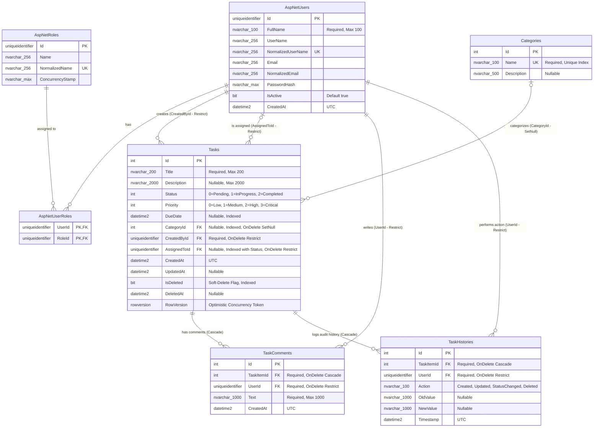

# TaskFlow SQL Server Database Schema & ER Diagram

## Entity-Relationship Diagram

## Soft-Delete Guarantee (Never Physically Deleted)

- **Global Query Filter (`HasQueryFilter(t => !t.IsDeleted)`):** All normal queries on `Tasks`, `TaskComments`, and `TaskHistories` automatically filter out soft-deleted tasks.
- **`SaveChanges` / `SaveChangesAsync` Interceptor (`ConvertTaskDeletesToSoftDelete`):**
  - Even if code calls `db.Tasks.Remove(task)`, `AppDbContext` intercepts `EntityState.Deleted`, converts the entry to `EntityState.Unchanged`, and marks only `IsDeleted = true`, `DeletedAt = DateTime.UtcNow`, and `UpdatedAt = DateTime.UtcNow` as modified.
  - Deferred cascade delete timing (`CascadeTiming.OnSaveChanges`) and `RevertDeletedDependents` guarantee that loaded `TaskComments` and `TaskHistories` are never physically deleted when a task is soft-deleted.
